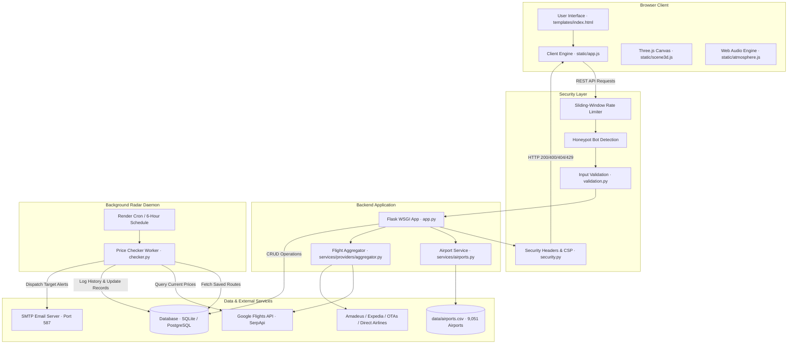

# SkyTracker — Technical System Architecture (`Architecture.md`)

**Document Version:** 1.0.0 (Production Release)
**System Name:** SkyTracker Backend & Frontend Architecture
**Status:** Live & Production Ready
**Companion Documents:** [PRD.md](file:///c:/Users/Vandita%20Mamgain/Downloads/flight-price-tracker/PRD.md) · [Rules.md](file:///c:/Users/Vandita%20Mamgain/Downloads/flight-price-tracker/Rules.md) · [Design.md](file:///c:/Users/Vandita%20Mamgain/Downloads/flight-price-tracker/Design.md) · [Task.md](file:///c:/Users/Vandita%20Mamgain/Downloads/flight-price-tracker/Task.md)
**Audience:** Software Architects, Full-Stack Engineers, DevOps Specialists, Security Auditors, and AI Agents (Antigravity, Cursor, Claude)

---

## 1. Technology Stack

SkyTracker is architected as a lean, high-performance web application utilizing modern Python and vanilla browser standards, avoiding bloated frontend frameworks to maximize render velocity and longevity.

| Layer | Technology | Version / Spec | Purpose |
| :--- | :--- | :--- | :--- |
| **Backend Framework** | [Flask](file:///c:/Users/Vandita%20Mamgain/Downloads/flight-price-tracker/app.py) | 3.1.3 | Lightweight WSGI web framework, REST routing, error handling |
| **Server Runtime** | Python | 3.13 | High-concurrency async-capable runtime |
| **WSGI Server** | [gunicorn](file:///c:/Users/Vandita%20Mamgain/Downloads/flight-price-tracker/requirements.txt) | 26.2.0 | Production HTTP server for Render deployment |
| **Database** | SQLite / PostgreSQL | [psycopg 3.3.6](file:///c:/Users/Vandita%20Mamgain/Downloads/flight-price-tracker/db.py) | Dual-engine persistence: local SQLite (`flights.db`) and managed PostgreSQL (`DATABASE_URL`) |
| **Frontend Core** | Vanilla HTML5 & ES6+ | Native Browser | Zero-compile client application (`static/app.js`, `atmosphere.js`, `scene3d.js`) |
| **Styling Engine** | Vanilla CSS3 | Custom Properties | Obsidian Noir & Warm Alabaster luxury design system (`static/style.css`) |
| **3D Graphics** | [Three.js](https://cdnjs.cloudflare.com/ajax/libs/three.js/r128/three.min.js) | r128 | WebGL celestial horizon sphere, particle constellation, camera drift |
| **Data Visualization**| [Chart.js](https://cdn.jsdelivr.net/npm/chart.js) | 4.4.x | Historical temporal price chronicle rendering |
| **External APIs** | Google Flights / SerpApi | REST JSON | Real-time global flight search aggregation |
| **Email Relay** | Python `smtplib` | RFC 5321 | TLS-encrypted SMTP price alert notifications |
| **Testing Suite** | [pytest](file:///c:/Users/Vandita%20Mamgain/Downloads/flight-price-tracker/pytest.ini) | 9.1.1 | 78 automated functional, security, and integration tests |
| **CI / CD & Hosting**| Render & GitHub Actions | Linux (Ubuntu) | Automated web deployment (`render.yaml`) and 6-hour cron service |

---

## 2. Repository Directory Structure

```
flight-price-tracker/
├── app.py                      # Core Flask application, routing, error handlers, middleware
├── security.py                 # Thread-safe rate limiter, CSP/HSTS headers, HMAC tokens, honeypots
├── validation.py               # Input validation (email RFC 5322, IATA regex, date sequences, passengers)
├── db.py                       # Database connection pooling & schema initialization (SQLite/PostgreSQL)
├── checker.py                  # Background price radar worker script; checks fares & sends SMTP alerts
├── render.yaml                 # Infrastructure-as-code specification for Render web & cron services
├── requirements.txt            # Python production dependencies (UTF-8 encoded)
├── pytest.ini                  # Pytest test configuration and testpaths
├── skytrack-preview.png        # Platform preview asset
│
├── data/
│   └── airports.csv            # Database of 9,051 international airports with IATA codes & coordinates
│
├── services/
│   ├── airports.py             # Haversine distance calculations and nearby hub discovery
│   ├── flight_api.py           # SerpApi search client, mock fallback aggregator, multi-city coordinator
│   └── providers/              # Multi-provider price comparison engine
│       ├── __init__.py         # Provider module exports
│       ├── base.py             # Abstract FlightProvider class, FlightOffer model, itinerary key hashing
│       ├── aggregator.py       # FlightAggregator: coordinates multi-provider search & groups offers
│       ├── serpapi_provider.py # Google Flights provider implementation via SerpApi
│       ├── amadeus_provider.py # Amadeus Flight Offers Search provider integration
│       ├── expedia_provider.py # Expedia flight search provider
│       ├── ota_partner_provider.py # MakeMyTrip, Cleartrip, EaseMyTrip aggregator providers
│       └── direct_airline_provider.py # Direct airline booking comparison provider
│
├── static/
│   ├── style.css               # Complete luxury CSS design system (tokens, components, responsive queries)
│   ├── app.js                  # Main client-side application (search, autocomplete, cards, tracking, comparison)
│   ├── atmosphere.js           # Ambient audio engine (Web Audio API), cursor glow, drawer controller
│   ├── scene3d.js              # Three.js 3D celestial horizon sphere, particles, responsive canvas
│   ├── favicon.svg             # Vector brand icon
│   ├── favicon.ico             # Standard 32x32 multi-resolution favicon
│   └── images/                 # Curated editorial photography (Amalfi, Kyoto, St. Moritz, Reykjavik)
│
├── templates/
│   ├── index.html              # Main application SPA template (contains all 80 mapped JS element IDs)
│   ├── privacy.html            # Public data privacy & platform compliance page
│   └── 404.html                # Custom luxury 404 error page with navigation fallbacks
│
└── tests/                      # Automated test suite (78 tests)
    ├── test_advanced_search.py # Search modes, passenger validation, multi-city legs
    ├── test_airports.py        # Airport lookup, distance math, nearby radius tests
    ├── test_db.py              # SQLite table schemas and CRUD operations
    ├── test_exact_comparison_flow.py # Provider comparison, deep links, itinerary hashing
    ├── test_flight_api.py      # Provider fallback resilience and response normalization
    ├── test_price_comparison.py# Aggregator grouping, price spread, and best offer logic
    ├── test_routes.py          # Flask HTTP routes, status codes, and security headers
    ├── test_security.py        # 14 security tests: email injection, rate limits, honeypot, IDOR, CSP
    ├── test_validation.py      # Validation helper tests
    └── test_swap_simulation.js # Node.js headless DOM swap simulation script
```

---

## 3. System Architecture & Component Interaction

The diagram below illustrates the end-to-end data flow between the browser client, Flask application, security enforcement middleware, persistence layer, external flight providers, and the background radar worker.



---

## 4. API Architecture & Endpoint Contracts

All API endpoints follow strict REST conventions, validate inputs server-side, apply sliding-window rate limiting, and emit JSON responses.

### 4.1. Endpoint Inventory

| Endpoint | Method | Rate Limit | Auth / Security | Request Payload | Response Schema |
| :--- | :--- | :--- | :--- | :--- | :--- |
| **`/api/airports`** | `GET` | 100 req/min | Public | Query params: `q` (string, max 50), `iata` (string, 3) | Array of matching airports: `[{"name", "city", "country", "iata", "latitude", "longitude"}]` |
| **`/api/search`** | `POST` | 40 req/min | Public + Bot Honeypot | `{"departure": "DEL", "arrival": "BOM", "outbound_date": "YYYY-MM-DD", "return_date": "...", "trip_type": "one_way", "passengers": 1, "travel_class": 1}` | `{"results": [...], "search_airports": {...}, "nearby_savings": {...}, "comparison": {...}}` |
| **`/api/flight/compare`** | `POST` | 40 req/min | Public + Bot Honeypot | `{"departure": "...", "arrival": "...", "outbound_date": "...", "flight": {...}}` | `{"flight_summary": {...}, "comparison_offers": [...], "grouped_itineraries": [...], "stats": {...}}` |
| **`/api/providers`** | `GET` | 60 req/min | Public | None | `{"providers": [{"code", "name", "type", "status", "features"}]}` |
| **`/api/track`** | `POST` | 15 req/min | Bot Honeypot + Email RFC 5322 | `{"departure": "...", "arrival": "...", "outbound_date": "...", "target_price": 5000, "email": "user@domain.com"}` | `{"message": "Flight tracking started!", "id": 12, "delete_token": "..."}` |
| **`/api/tracked`** | `GET` | 60 req/min | Public / Scoped | None | Array of active tracked routes (user emails excluded for privacy) |
| **`/api/radar/status`** | `GET` | 60 req/min | Public | None | `{"status": "Active", "status_detail": "...", "tracked_count": 5, "last_checked": "..."}` |
| **`/api/history/<id>`** | `GET` | 60 req/min | ID Verification | URL parameter: `tracked_id` (integer) | Array of price records: `[{"price": 4500, "checked_at": "..."}]`; HTTP 404 if ID missing |
| **`/api/tracked/<id>`** | `DELETE`| 30 req/min | HMAC Token Check (`X-Delete-Token`) | URL parameter: `tracked_id` (integer) | `{"message": "Tracked flight removed.", "id": 12}`; HTTP 404 if missing, 403 if token invalid |

---

## 5. Data Architecture & Database Schema

SkyTracker maintains database transparency across SQLite and PostgreSQL through standard ANSI SQL queries executed via [db.py](file:///c:/Users/Vandita%20Mamgain/Downloads/flight-price-tracker/db.py).

### 5.1. Table: `tracked_flights`
Stores registered price radar alert requests.

| Column | PostgreSQL Type | SQLite Type | Constraints | Description |
| :--- | :--- | :--- | :--- | :--- |
| `id` | `BIGSERIAL` | `INTEGER` | `PRIMARY KEY AUTOINCREMENT` | Unique tracking record identifier |
| `departure` | `TEXT` | `TEXT` | `NOT NULL` | 3-letter IATA origin airport code |
| `arrival` | `TEXT` | `TEXT` | `NOT NULL` | 3-letter IATA destination airport code |
| `outbound_date`| `TEXT` | `TEXT` | `NOT NULL` | ISO 8601 outbound date (`YYYY-MM-DD`) |
| `return_date` | `TEXT` | `TEXT` | `NULL` | ISO 8601 return date for round trips |
| `target_price` | `DOUBLE PRECISION` | `REAL` | `NOT NULL` | User's target price threshold in INR (₹) |
| `email` | `TEXT` | `TEXT` | `NOT NULL` | Validated recipient email for price alerts |
| `lowest_price` | `DOUBLE PRECISION` | `REAL` | `NULL` | Historical lowest price recorded |
| `last_price` | `DOUBLE PRECISION` | `REAL` | `NULL` | Most recent flight price fetched by checker |
| `created_at` | `TEXT` | `TEXT` | `NOT NULL` | ISO 8601 UTC creation timestamp |
| `target_alert_sent` | `INTEGER` | `INTEGER` | `DEFAULT 0` | Flag (`0` or `1`) preventing duplicate target alerts |

### 5.2. Table: `price_history`
Maintains temporal price audit chronicles for tracked routes.

| Column | PostgreSQL Type | SQLite Type | Constraints | Description |
| :--- | :--- | :--- | :--- | :--- |
| `id` | `BIGSERIAL` | `INTEGER` | `PRIMARY KEY AUTOINCREMENT` | Unique history record identifier |
| `tracked_id` | `BIGINT` | `INTEGER` | `NOT NULL, REFERENCES tracked_flights(id)` | Foreign key linking to parent tracked flight |
| `price` | `DOUBLE PRECISION` | `REAL` | `NOT NULL` | Recorded price quote at check timestamp |
| `checked_at` | `TEXT` | `TEXT` | `NOT NULL` | ISO 8601 UTC timestamp of check execution |

---

## 6. Reliability & Resilience Patterns

1. **Configurable Primary Flight Search Provider (`PRIMARY_FLIGHT_PROVIDER`):**
   - Configurable via `PRIMARY_FLIGHT_PROVIDER` environment variable (options: `serpapi` or `amadeus`, default: `serpapi`).
   - The provider registry in [services/providers/__init__.py](file:///c:/Users/Vandita%20Mamgain/Downloads/flight-price-tracker/services/providers/__init__.py) maps strictly to genuine upstream adapters (`serpapi` -> `SerpApiFlightsProvider`, `amadeus` -> `AmadeusFlightProvider`).
   - Misleading aliases like `google_flights` are removed; selecting SerpAPI truthfully labels results as SerpAPI, never as an independent Google Flights API.
   - When Amadeus is selected as the primary provider, requests route through its dedicated adapter without silently falling back to SerpAPI if Amadeus fails or its quota is exhausted.
   - When unconfigured or quota exhausted, honest unavailable responses (HTTP 503) or clearly labeled valid cached results are returned.
2. **Provider Aggregator Comparison Matrix:**
   - [services/providers/aggregator.py](file:///c:/Users/Vandita%20Mamgain/Downloads/flight-price-tracker/services/providers/aggregator.py) orchestrates multi-provider searches across SerpAPI, Amadeus GDS, airline direct channels, and OTA partners.
   - Individual provider failures do not fail the overall search; remaining healthy providers continue to populate the comparison matrix.
3. **Database Resilience:**
   - Database operations use `try ... finally: conn.close()` to prevent connection leaks.
   - Dual-mode connection factory in [db.py](file:///c:/Users/Vandita%20Mamgain/Downloads/flight-price-tracker/db.py) transparently selects PostgreSQL when `DATABASE_URL` is set, or local SQLite otherwise.
   - **Production Requirement:** PostgreSQL (`DATABASE_URL`) is strictly mandatory for production deployments (Render/cloud containers) because host container filesystems are ephemeral and SQLite files are wiped upon dyno restart or redeployment. SQLite is strictly reserved for local development and unit testing. Schema initialization uses non-destructive `CREATE TABLE IF NOT EXISTS` preserving all existing production data.
3. **Payload Protection:**
   - Maximum incoming request size is clamped to 1MB (`app.config["MAX_CONTENT_LENGTH"] = 1 * 1024 * 1024`), preventing memory starvation attacks.

---

## 7. Security Architecture

1. **Defense-in-Depth Headers ([security.py](file:///c:/Users/Vandita%20Mamgain/Downloads/flight-price-tracker/security.py)):**
   - Injected on all responses via `@app.after_request`.
   - Content-Security-Policy (CSP) restricts scripts, styles, objects, and frame ancestry.
   - Strict-Transport-Security (HSTS) with 1-year duration and preload enabled over HTTPS.
2. **Parameterized SQL Queries:**
   - Every query in [app.py](file:///c:/Users/Vandita%20Mamgain/Downloads/flight-price-tracker/app.py) and [checker.py](file:///c:/Users/Vandita%20Mamgain/Downloads/flight-price-tracker/checker.py) uses positional parameter substitution (`%s` or `?`), eliminating SQL injection vulnerabilities.
3. **IDOR Mitigation via Cryptographic Tokens:**
   - Tracked flights issue an HMAC-SHA256 signature upon creation.
   - Deletion requires record verification and token authentication, preventing unauthorized deletion of neighboring rows.
4. **Header Injection Defense:**
   - Email inputs are scrubbed of `\r` and `\n` characters before reaching SMTP transport.

---

## 8. Extension Guidelines for Future Developers

### 8.1. Adding a New Flight Provider
1. Create `services/providers/new_provider.py` inheriting from `FlightProvider` in [services/providers/base.py](file:///c:/Users/Vandita%20Mamgain/Downloads/flight-price-tracker/services/providers/base.py).
2. Implement `search(departure, arrival, outbound_date, return_date, travel_class, adults, children, infants) -> List[FlightOffer]`.
3. Register the provider instance in `FlightAggregator.__init__()` in [services/providers/aggregator.py](file:///c:/Users/Vandita%20Mamgain/Downloads/flight-price-tracker/services/providers/aggregator.py).
4. Add unit and integration tests in `tests/test_price_comparison.py`.

### 8.2. Adding a New API Endpoint
1. Define the route in [app.py](file:///c:/Users/Vandita%20Mamgain/Downloads/flight-price-tracker/app.py) with explicit HTTP method decorators (`@app.get` or `@app.post`).
2. Attach `@rate_limit(limit=N, window=60)` from [security.py](file:///c:/Users/Vandita%20Mamgain/Downloads/flight-price-tracker/security.py).
3. Add server-side validation functions in [validation.py](file:///c:/Users/Vandita%20Mamgain/Downloads/flight-price-tracker/validation.py).
4. Write corresponding regression tests in `tests/test_routes.py` and run `python -m pytest tests/`.
