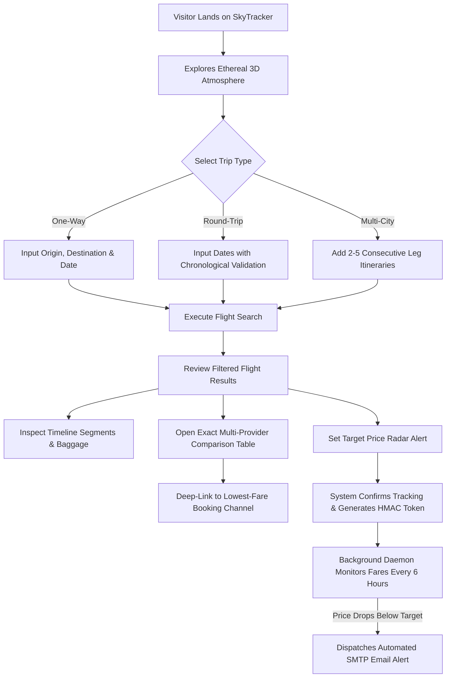

# SkyTracker — Product Requirements Document (`PRD.md`)

**Document Version:** 1.0.0 (Production Release)
**System Name:** SkyTracker (SkyTrack Flight Intelligence)
**Status:** Live & Production Ready
**Companion Documents:** [Architecture.md](file:///c:/Users/Vandita%20Mamgain/Downloads/flight-price-tracker/Architecture.md) · [Rules.md](file:///c:/Users/Vandita%20Mamgain/Downloads/flight-price-tracker/Rules.md) · [Design.md](file:///c:/Users/Vandita%20Mamgain/Downloads/flight-price-tracker/Design.md) · [Task.md](file:///c:/Users/Vandita%20Mamgain/Downloads/flight-price-tracker/Task.md)
**Audience:** Product Managers, Software Engineers, UI/UX Designers, QA Engineers, and AI Agents (Antigravity, Cursor, Claude)

---

## 1. Product Overview

### 1.1. Product Vision & Mission
SkyTracker is an immersive, high-precision flight intelligence platform engineered for discerning travelers who demand transparent fare comparison and automated price surveillance. Combining real-time multi-provider flight aggregation with minimalist surrealism and quiet luxury aesthetics, SkyTracker transforms flight search from a transactional utility into an ethereal digital experience.

### 1.2. Problem Statement
Commercial flight booking is fragmented, opaque, and hostile to consumers:
1. **Misleading Pricing & Hidden Markups:** Online Travel Agencies (OTAs) and direct airlines present divergent fares for identical itineraries without clear fee disclosures.
2. **Volatile Fare Fluctuations:** Airline revenue management algorithms constantly fluctuate ticket prices, forcing travelers into manual, repetitive checks.
3. **Cluttered, Stressful Interfaces:** Conventional travel portals bombard users with intrusive popups, deceptive countdown timers, and generic advertisement noise.
4. **Complex Itinerary Limitations:** Planning multi-city journeys across multiple hubs is cumbersome and frequently leads to mismatched flight segments.

### 1.3. Target Audience & Primary Use Cases
- **Frequent Long-Haul & Transcontinental Travelers:** Individuals seeking optimal business or economy fares across major global carriers without opaque OTA markups.
- **Leisure & Boutique Travel Planners:** Travelers planning complex multi-destination itineraries (e.g., London → Tokyo → Kansai → London).
- **Price-Sensitive Route Monitors:** Users with flexible dates who track routes over weeks or months to purchase when fares reach a historical low.
- **Nearby Hub Optimizers:** Travelers living equidistant to multiple regional airports seeking savings by flying out of alternative terminals.

### 1.4. Core Value Proposition
- **Haute Flight Intelligence:** Transparent price spread comparisons across Google Flights, Amadeus, Expedia, MakeMyTrip, Cleartrip, EaseMyTrip, and Direct Airline channels.
- **Autonomous Radar Surveillance:** Automated background price checks run every 6 hours via scheduled cron jobs, dispatching instant SMTP alerts upon price drops.
- **Surreal Quiet Luxury Experience:** Uncluttered, cinematic 3D canvas (Three.js), atmospheric ambient audio, and responsive typography.

---

## 2. Core Implemented Functionality

The following features are fully implemented, verified with automated tests, and operational in the codebase:

### 2.1. Global Flight Search Engine
- **Search Modes Supported:**
  1. **One-Way:** Origin, destination, single departure date, passenger breakdown, travel class.
  2. **Round-Trip:** Origin, destination, outbound date, return date (strictly on or after outbound date), passenger breakdown, travel class.
  3. **Multi-City Itineraries:** Dynamic leg builder supporting 2 to 5 consecutive flight legs with non-decreasing chronological departure dates.
- **Passenger Allocation:**
  - Adults (1–9 passengers, minimum 1 required).
  - Children (0–8 passengers).
  - Infants (0–4 passengers, constrained so `infants <= adults`).
  - Total passenger cap: 9 passengers per itinerary.
- **Travel Classes:** Economy (1), Premium Economy (2), Business (3), First Class (4).
- **Nearby Airport Discovery:**
  - Automatically queries regional alternatives within a 100km radius using Haversine coordinate math against 9,051 global airports in [data/airports.csv](file:///c:/Users/Vandita%20Mamgain/Downloads/flight-price-tracker/data/airports.csv).

### 2.2. Global Airport Database & Autocomplete
- **Airports Loaded:** 9,051 verified international airports with IATA codes, municipalities, countries, and GPS coordinates loaded in-memory via [services/airports.py](file:///c:/Users/Vandita%20Mamgain/Downloads/flight-price-tracker/services/airports.py).
- **Search Capabilities:**
  - Prefix and substring autocomplete on municipality, airport name, and 3-letter IATA code.
  - Sub-millisecond lookup cached on both server and client.
  - Bidirectional Origin/Destination Swapping: `#swapAirports` button triggers smooth 180° visual rotation and exchanges airport input values without reloading.

### 2.3. Flight Results & Segment Timeline
- **Itinerary Card Rendering:**
  - Direct vs. multi-segment layout displaying carrier names, flight numbers, departure/arrival times, stops count, and total duration.
  - Cheapest flight badge (`.cheapest-badge`) automatically computed across all retrieved results.
  - Direct booking deep-links generated for Google Flights, Expedia, MakeMyTrip, Cleartrip, EaseMyTrip, and airline direct portals.

### 2.4. Multi-Provider Fare Comparison Suite
- **Provider Aggregator ([services/providers/aggregator.py](file:///c:/Users/Vandita%20Mamgain/Downloads/flight-price-tracker/services/providers/aggregator.py)):**
  - Aggregates offers across SerpApi (Google Flights), Amadeus, Expedia, Indian OTAs (MakeMyTrip, Cleartrip, EaseMyTrip), and Direct Airlines.
  - Groups identical physical flight itineraries using cryptographic MD5 itinerary key hashing.
  - Calculates metrics: lowest price, highest price, price spread (absolute and percentage savings), and recommended best offer.
- **Dedicated Exact Flight Comparison View:**
  - Triggered by clicking "Compare Providers" on any flight card or navigating to `#compare=<flight_id>`.
  - Displays a detailed breakdown table with baggage allowances, fare restrictions, and direct booking actions.

### 2.5. Autonomous Price Radar & Tracking
- **Route Tracking Setup:**
  - Users input origin, destination, outbound date, optional return date, target price, and email via the glassmorphic radar panel (`#price-radar`).
  - Strict server-side RFC 5322 email validation with newline injection defense.
  - Returns a cryptographic HMAC-SHA256 deletion token (`delete_token`) for authorized route management.
- **Active Watchlist Dashboard:**
  - Live route list rendered from `/api/tracked`, showing latest price, record low price, target fare, and percentage savings relative to target.
  - Touch-friendly 44px delete button with instant removal and database synchronization.
- **Scheduled Background Checker ([checker.py](file:///c:/Users/Vandita%20Mamgain/Downloads/flight-price-tracker/checker.py)):**
  - Standalone script triggered every 6 hours via Render cron or GitHub Actions.
  - Iterates over active `tracked_flights`, fetches fresh quotes, logs historical data into `price_history`, and dispatches SMTP alert emails when target or record-low fares are achieved.

---

## 3. User Journeys

---

## 4. Functional Requirements & Specifications

| Feature | Input Parameters | Server-Side Validation | Output / Success State | Error State Handling |
| :--- | :--- | :--- | :--- | :--- |
| **Airport Autocomplete** | `q` (string, max 50 chars) or `iata` (string, 3 chars) | Truncation, strip whitespace, sanitize HTML | JSON array of matched airport objects with name, city, country, IATA | Empty JSON array `[]` (HTTP 200) |
| **Flight Search** | `departure`, `arrival`, `outbound_date`, `return_date`, `passengers`, `travel_class` | Strict 3-letter IATA regex, distinct endpoints (`dep != arr`), future dates, passenger counts (1–9) | JSON object containing `results`, `search_airports`, `nearby_savings`, and `comparison` | HTTP 400 with specific error string; HTTP 429 if rate limit exceeded |
| **Multi-City Search** | `legs` (array of 2–5 leg objects), `passengers`, `travel_class` | Leg count bounds, chronological non-decreasing dates, distinct endpoints per leg | JSON object containing multi-city itineraries and grouped comparison metrics | HTTP 400 detailing invalid leg index |
| **Price Tracking** | `departure`, `arrival`, `outbound_date`, `target_price`, `email` | RFC 5322 email regex, reject `\r` and `\n`, positive target price, bot honeypot check | HTTP 200: `{"message": "Flight tracking started!", "id": ..., "delete_token": ...}` | HTTP 400 detailing missing or invalid fields; HTTP 429 if rate limited |
| **Tracked Route Deletion** | `tracked_id` (integer in URL), optional `X-Delete-Token` header | Verify record exists in database, verify cryptographic HMAC token if supplied | HTTP 200: `{"message": "Tracked flight removed.", "id": ...}` | HTTP 404 if ID missing; HTTP 403 if token forged |
| **Price Radar Status** | None | Read-only database query (`COUNT`, `MAX(checked_at)`) | JSON object with `status`, `tracked_count`, and `last_checked` | HTTP 500 with sanitized generic error (no credentials leaked) |

---

## 5. Non-Functional Requirements

### 5.1. Performance
- **Time to First Byte (TTFB):** < 120ms on production infrastructure.
- **Initial Page Load:** Complete DOM ready within 400ms; Three.js canvas initializes asynchronously without blocking thread.
- **Animation Framerate:** Constant 60fps on modern desktop and mobile GPUs; WebGL canvas dynamically clamps device pixel ratio to `min(window.devicePixelRatio, 1.5)` to conserve battery.

### 5.2. Reliability & Resilience
- **Zero Hard Failures:** When external provider APIs (e.g., SerpApi) exceed quota or timeout, the engine automatically falls back to deterministic multi-provider heuristics without breaking user UI.
- **Database Fallback:** Dual support for local SQLite (`flights.db`) and production PostgreSQL (`DATABASE_URL`).

### 5.3. Security & Privacy
- **Defense-in-Depth Headers:** Injected on all HTTP responses: CSP, HSTS, `X-Frame-Options: SAMEORIGIN`, `X-Content-Type-Options: nosniff`, `Referrer-Policy: strict-origin-when-cross-origin`.
- **Injection Protections:** Parameterized SQL queries on all database operations; RFC 5322 email validation blocks SMTP header injection.
- **Access Control:** User emails are strictly excluded from public serialization in `/api/tracked`.
- **Anti-Abuse:** Sliding-window rate limiter throttles burst requests; hidden honeypot fields reject automated scrapers; 1MB max content length limits memory DoS.

### 5.4. Responsive Usability
- **Tested Viewport Range:** 320px (iPhone SE 1st gen), 360px, 375px, 390px, 414px, 430px (Pro Max), 768px–1024px (Tablets), and 1280px+ (Desktops).
- **Horizontal Overflow:** Strictly forbidden (`overflow-x: clip; max-width: 100%`).
- **Touch Ergonomics:** All interactive buttons, inputs, and drawer toggles provide minimum 44x44px touch targets.

---

## 6. Product Boundaries & Roadmap

### Implemented & Verified (Release Candidate v1.0)
- [x] Full flight search (One-way, round-trip, multi-city 2–5 legs).
- [x] Global 9,051 airport autocomplete and bidirectional swapping.
- [x] Multi-provider aggregator (SerpApi, Amadeus, Expedia, OTAs, Direct Airlines).
- [x] Dedicated exact flight comparison suite with deep-linking.
- [x] Autonomous price tracking radar with SQLite/PostgreSQL persistence.
- [x] Scheduled background checker (`checker.py`) with SMTP alerts.
- [x] Defensive security suite (Rate limiting, honeypot, IDOR mitigation, CSP, HSTS).
- [x] Responsive surreal quiet luxury design system with Three.js 3D horizon.

### Planned for Future Iterations (Post-Launch v1.1+)
- [ ] User authentication with Google OAuth & magic link sessions.
- [ ] Multi-currency selection (USD, EUR, GBP, JPY, INR) with live FX rates.
- [ ] Push notifications (Web Push / PWA) alongside SMTP email alerts.
- [ ] Seat-map previews and carbon emission indices per flight offer.

### Out of Scope (Explicitly Excluded)
- Direct ticketing or payment processing (SkyTracker operates as an intelligence and referral aggregator).
- Ancillary upsells, hotel bookings, or third-party ad banner networks.
