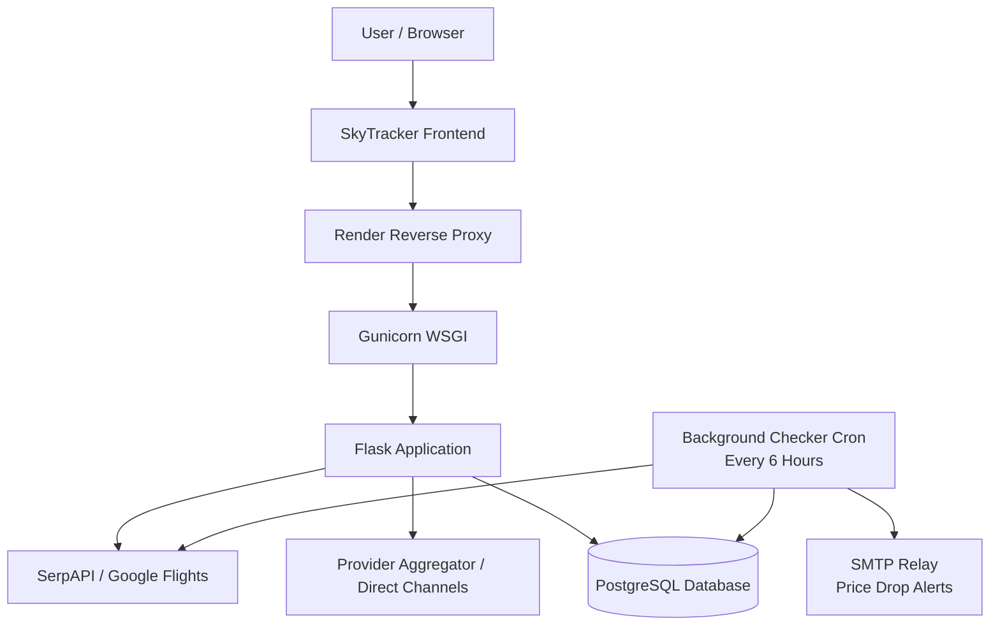

# SkyTracker — Flight Price Tracker

A full-stack flight intelligence and price-tracking application built with Flask, PostgreSQL, and JavaScript.

SkyTracker enables travelers to discover flights, compare fares across direct airline portals and aggregators, monitor route price trajectories, and receive automated email alerts when fares drop or achieve target thresholds.

## Features

- Multi-source flight search across domestic and international IATA hubs
- One-way, round-trip, and multi-city route search
- Canonical airport resolution with city aliases (e.g., Bombay/Mumbai, Madras/Chennai)
- Multi-provider comparison matrix across direct airline channels and aggregators
- Autonomous price radar tracking with custom target thresholds
- Confirmed price-drop detection and threshold alerts
- Historical price observation chronicles
- Periodic background checker execution (6-hour Render cron schedule)
- Configurable electronic support and persisted contact desk
- Strict data-status disclosure (live provider fares vs. demonstration benchmarks)
- Surreal Quiet Luxury dark aesthetic (Obsidian Noir, champagne gold, restrained motion)
- Defense-in-depth security (production secret key enforcement, parameterized SQL, rate limiting, anti-bot honeypots, secure session cookies)

## Tech Stack

### Backend
- Python 3.13+
- Flask & Gunicorn
- Google Flights via SerpAPI
- PostgreSQL (Production) / SQLite (Local development)
- SMTP via TLS (Gmail or custom relay)

### Frontend
- HTML5 & Semantic Web Components
- Vanilla CSS with CSS custom property design system
- Vanilla JavaScript (ES6+ modular architecture)
- WebGL & procedural celestial background canvases

### Testing & Verification
- pytest (Unit, integration, route, security, and comparison suites)
- Node.js test scripts for frontend state and template validation
- GitHub Actions CI

### Deployment
- Render Web Service (`gunicorn -w 2 -b 0.0.0.0:$PORT app:app`)
- Render Cron Job (`0 */6 * * *` executing `checker.py`)
- Persistent PostgreSQL (`DATABASE_URL`)

## Architecture



## Data Flow

1. **User Search**: The user enters an origin, destination, travel dates, passenger counts, and cabin class.
2. **Validation**: The backend canonicalizes IATA codes, verifies date sequences, and enforces origin != destination.
3. **Live Query**: Live Google Flights results are retrieved via SerpAPI when configured. If unconfigured or quota-exhausted, demonstration benchmarks are returned with clear truthfulness disclosures.
4. **Comparison**: Reference itineraries are matched against direct carrier channels and authorized aggregator rate estimates.
5. **Radar Tracking**: Tracked routes are persisted with target thresholds.
6. **Background Surveillance**: `checker.py` runs periodically (every 6 hours). Verified price drops or reached target thresholds dispatch email alerts. Initial price observations are recorded as baselines without triggering false alerts.

## Project Structure

```text
flight-price-tracker/
|-- app.py                    # Flask application routes, API endpoints, rate limits
|-- checker.py                # Periodic background price radar checker and email dispatcher
|-- db.py                     # Database connection and non-destructive schema migrations
|-- security.py               # Security headers, rate limiting, CSRF tokens, honeypots
|-- validation.py             # Airport, date, passenger, and itinerary validation rules
|-- requirements.txt          # Production Python dependencies
|-- render.yaml               # Infrastructure-as-code specification for Render
|-- README.md                 # Project documentation and truthfulness manifesto
|
|-- data/
|   `-- airports.csv          # Global airport dataset with IATA codes and coordinates
|
|-- services/
|   |-- airports.py           # Airport database index, Haversine distance, city aliases
|   |-- flight_api.py         # SerpAPI client, itinerary normalization, demo benchmarks
|   `-- providers/
|       |-- base.py           # BaseFlightProvider, FlightOffer dataclass, data status contract
|       |-- aggregator.py     # Multi-provider comparison coordinator and itinerary matching
|       |-- serpapi_provider.py # Google Flights live provider
|       |-- direct_airline_provider.py # Direct carrier booking channel adapter
|       |-- expedia_provider.py # Expedia partner provider adapter
|       `-- ota_partner_provider.py # MakeMyTrip, Cleartrip, EaseMyTrip partner adapter
|
|-- static/
|   |-- app.js                # Search console, autocomplete, comparison, tracking logic
|   |-- appearance.js         # Theme selection, custom accent colors, preference persistence
|   |-- backdrops.js          # Procedural WebGL atmospheric backdrops
|   |-- style.css             # Surreal Quiet Luxury design system and responsive layout
|   |-- manifest.json         # PWA installation manifest
|   `-- sw.js                 # Service worker caching static assets with zero telemetry
|
|-- templates/
|   |-- base.html             # Common shell, navigation, appearance bootstrap, footer
|   |-- index.html            # Main search sanctum, horizons, price watch console
|   |-- flights.html          # Standalone flight search and results explorer
|   |-- compare.html          # Multi-provider comparison matrix
|   |-- tracking.html         # Price radar dashboard and alert management
|   |-- appearance.html       # Appearance & personalization settings
|   |-- contact.html          # Secure inquiry form and operational status
|   |-- about.html            # Product manifesto and architectural standards
|   |-- privacy.html          # Privacy policy and data ownership guarantees
|   `-- terms.html            # Terms of service and disclaimer of booking liability
|
|-- tests/
|   |-- test_advanced_search.py
|   |-- test_airports.py
|   |-- test_appearance.py
|   |-- test_db.py
|   |-- test_exact_comparison_flow.py
|   |-- test_flight_api.py
|   |-- test_price_comparison.py
|   |-- test_routes.py
|   |-- test_search_flow.py
|   |-- test_security.py
|   `-- test_validation.py
|
`-- .github/
    `-- workflows/
        |-- ci.yml            # Automated pytest test pipeline
        `-- flight-checker.yml # Optional scheduled GitHub Actions workflow
```

## Production Deployment

SkyTracker is designed for deployment on Render:

- **Web Service**: Gunicorn WSGI server (`gunicorn -w 2 -b 0.0.0.0:$PORT app:app`)
- **Background Worker**: Render Cron Job running `python checker.py` on a `0 */6 * * *` schedule (every 6 hours).
- **Database**: Managed PostgreSQL (`DATABASE_URL`). The application requires PostgreSQL in production; silent fallback to ephemeral SQLite is blocked.

### Environment Configuration

| Variable | Requirement | Description |
|---|---|---|
| `SECRET_KEY` | Mandatory in production | High-entropy secret for secure session cookie signing |
| `DATABASE_URL` | Mandatory in production | PostgreSQL connection URI with SSL (`sslmode=require`) |
| `FLASK_ENV` | Optional | Set to `production` in live environments |
| `SERPAPI_KEY` | Optional | SerpAPI key for live Google Flights queries (demo mode active if omitted) |
| `SUPPORT_EMAIL` | Optional | Verified recipient email address for support communications |
| `SMTP_HOST` | Optional | SMTP mail server hostname for price alerts |
| `SMTP_PORT` | Optional | SMTP port (typically `587`) |
| `SMTP_USERNAME` | Optional | SMTP account username / email address |
| `SMTP_PASSWORD` | Optional | SMTP account password or app-specific token |

## Testing

Run the complete test suite locally:

```powershell
.venv\Scripts\python.exe -m pytest tests/
```

Run frontend JavaScript test suites:

```powershell
node tests/test_frontend_appearance.js
node tests/test_frontend_search_flow.js
node tests/test_swap_simulation.js
```

## Security & Privacy Commitments

- **Zero Tracking Cookies**: No marketing pixels, behavioral telemetry, or commercial tracking scripts.
- **Data Minimization**: Radar alerts retain only the route, target threshold, and notification email address.
- **Immediate Purge**: Users can delete tracked itineraries at any time using their deletion token or dashboard controls.
- **Truthful Data Status**: Demonstration benchmarks and estimated fares are explicitly distinguished from live provider prices.