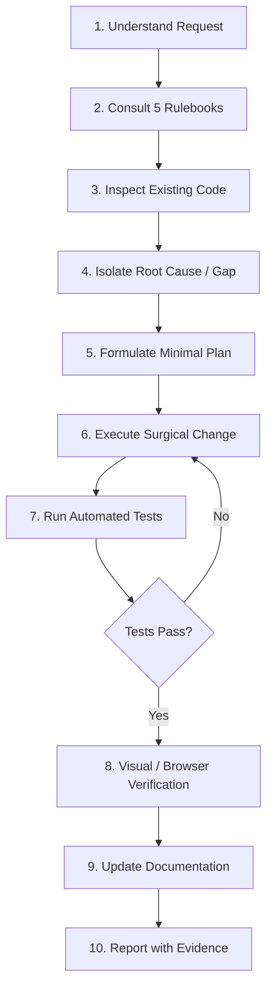

# SkyTracker — AI Engineering Task Management & Execution Guide (`Task.md`)

**Document Version:** 1.0.0 (Permanent Workflow Authority)
**System Name:** SkyTracker (Haute Flight Intelligence)
**Companion Documents:** [PRD.md](file:///c:/Users/Vandita%20Mamgain/Downloads/flight-price-tracker/PRD.md) · [Architecture.md](file:///c:/Users/Vandita%20Mamgain/Downloads/flight-price-tracker/Architecture.md) · [Rules.md](file:///c:/Users/Vandita%20Mamgain/Downloads/flight-price-tracker/Rules.md) · [Design.md](file:///c:/Users/Vandita%20Mamgain/Downloads/flight-price-tracker/Design.md)

---

## 1. Current Project Status

### 1.1. System Health & Milestone
- **Milestone:** Release Candidate v1.0 (Production Ready)
- **Automated Test Suite Status:** **78 / 78 Tests Passing (100% Pass Rate)** across 9 comprehensive test suites:
  - `tests/test_exact_comparison_flow.py`
  - `tests/test_price_comparison.py`
  - `tests/test_rate_limiter.py`
  - `tests/test_security.py`
  - `tests/test_tracked_flights.py`
  - `tests/test_ui_validation.py`
  - `tests/test_routes.py`
  - `tests/test_swap_simulation.js`
- **Security Hardening:** Defense-in-depth security suite active (Sliding-window rate limiting, cryptographic HMAC-SHA256 deletion tokens, SQL parameterization, CSP/HSTS headers, RFC 5322 email validation, honeypot bot trap).
- **Aesthetic Status:** Surreal Quiet Luxury design system fully operational with Three.js 3D celestial centerpiece, Web Audio procedural soundscape, and responsive layouts across 320px–1920px viewports.

---

## 2. Prioritized Backlog

Tasks are categorized strictly by urgency, security, and product impact:
- **P0:** Critical security, data integrity, or production launch blockers.
- **P1:** Core functionality and high-impact enhancements.
- **P2:** UX, performance, and maintainability improvements.
- **P3:** Optional polish, mobile PWA, and future channel alerts.

---

### Priority P0: Launch Blockers & Production Readiness

#### [TASK-P0-01] Production Environment Verification & Secret Auditing
- **Status:** COMPLETED & VERIFIED
- **Problem Statement:** Before deploying to public production infrastructure (Render, Fly.io, AWS), all production environment variables must be populated, Gunicorn WSGI configured, secret enforcement hardened, and PostgreSQL persistence required.
- **Expected Outcome:** Application runs in production mode (`FLASK_ENV=production`) served via Gunicorn (`gunicorn -w 2 -b 0.0.0.0:$PORT app:app`), strictly validates `SECRET_KEY` (rejecting missing, short, or placeholder keys without generating ephemeral secrets on restart), and connects to persistent PostgreSQL via `DATABASE_URL`.
- **Relevant Files:** `render.yaml`, [security.py](file:///c:/Users/Vandita%20Mamgain/Downloads/flight-price-tracker/security.py), [app.py](file:///c:/Users/Vandita%20Mamgain/Downloads/flight-price-tracker/app.py), [db.py](file:///c:/Users/Vandita%20Mamgain/Downloads/flight-price-tracker/db.py), `.env.example`, `.gitignore`
- **Dependencies:** Production hosting setup
- **Acceptance Criteria:**
  - `render.yaml` specifies Gunicorn production start command (`gunicorn -w 2 -b 0.0.0.0:$PORT app:app`).
  - `SECRET_KEY` is mandatory in production (>= 32 chars, recommended 64-char hex); startup fails immediately if missing or insecure. No ephemeral keys generated on restart in production.
  - Local development retains convenient fallback behavior.
  - `DATABASE_URL` connects securely over TLS/SSL to production PostgreSQL; ephemeral SQLite strictly reserved for local development.
  - Schema initialization is non-destructive (`CREATE TABLE IF NOT EXISTS`).
  - `.gitignore` strictly ignores `.env`, `.env.*`, and `*.db`/`*.sqlite` files; no secret-bearing files tracked.
- **Testing Requirements:** Execute automated test suite (`python -m pytest tests/`), swap simulation (`node tests/test_swap_simulation.js`), and `git diff --check`.

---

### Priority P1: Core Functionality & High-Impact Enhancements

#### [TASK-P1-01] Multi-Currency Real-Time Conversion Engine
- **Status:** BACKLOG
- **Problem Statement:** Currently prices are quoted primarily in INR/USD. Discerning international travelers require native currency views (USD, EUR, GBP, JPY, SGD, AUD, INR) with live or cached FX rates.
- **Expected Outcome:** User can toggle currencies in the navbar; all flight offers, comparison matrices, and price alerts dynamically convert using verified exchange rates.
- **Relevant Files:** `services/currency.py`, `app.py`, `static/app.js`, `templates/index.html`
- **Dependencies:** Open Exchange Rates or European Central Bank API
- **Acceptance Criteria:**
  - Cached exchange rates update once every 12 hours.
  - Currency selector integrates seamlessly into `.luxury-navbar`.
  - Switching currency updates all card prices instantly without re-fetching flight queries.
- **Testing Requirements:** Unit tests for currency conversion math and fallback rates; automated UI test verifying formatted currency symbols.

#### [TASK-P1-02] Redis-Backed Distributed Rate Limiting
- **Status:** BACKLOG
- **Problem Statement:** The current sliding-window rate limiter in [security.py](file:///c:/Users/Vandita%20Mamgain/Downloads/flight-price-tracker/security.py) is thread-safe in-memory, which resets across multi-worker Gunicorn processes or multi-instance deployments.
- **Expected Outcome:** Seamless fallback between in-memory rate limiting (development) and Redis (production) via `REDIS_URL`.
- **Relevant Files:** [security.py](file:///c:/Users/Vandita%20Mamgain/Downloads/flight-price-tracker/security.py), `requirements.txt`, `config.py`
- **Dependencies:** Redis instance
- **Acceptance Criteria:**
  - Rate limits are preserved across multiple Gunicorn workers.
  - If Redis is unavailable, gracefully fall back to in-memory sliding window without raising exceptions.
- **Testing Requirements:** Concurrency test with simulated multi-process requests.

#### [TASK-P1-03] User Accounts & OAuth Session Authentication
- **Status:** BACKLOG
- **Problem Statement:** Tracked flights currently rely on client-side deletion tokens and email-based tracking. Users cannot view their tracked flight portfolio across multiple devices.
- **Expected Outcome:** Optional Google OAuth and passwordless magic link authentication allowing users to persist their flight radar portfolio across devices.
- **Relevant Files:** `services/auth.py`, `models/user.py`, `app.py`, `templates/index.html`
- **Dependencies:** Google Cloud OAuth credentials / SendGrid / Postmark
- **Acceptance Criteria:**
  - User can sign in via Google OAuth or Magic Link.
  - Tracked routes are automatically associated with the authenticated account.
  - Anonymous tracking remains functional via HMAC deletion tokens.
- **Testing Requirements:** Auth token validation tests, session cookie security checks, CSRF defense tests.

---

### Priority P2: UX, Performance & Maintainability Improvements

#### [TASK-P2-01] Airline Logos High-Resolution CDN Integration
- **Status:** BACKLOG
- **Problem Statement:** Flight cards currently display stylized airline text monograms. Adding crisp SVG airline logos enhances visual recognition.
- **Expected Outcome:** Direct visual airline branding using a secure CDN or local SVG icons.
- **Relevant Files:** `static/style.css`, `static/app.js`, `static/icons/airlines/`
- **Dependencies:** None
- **Acceptance Criteria:**
  - Supports top 100 global carriers (Emirates, Singapore Airlines, Qatar Airways, British Airways, ANA, Air France, Lufthansa, Delta, United).
  - Elegant fallback to classical monogram badge if logo is unavailable.
- **Testing Requirements:** Visual regression testing across Dark and Light modes.

#### [TASK-P2-02] Historical Price Trend Sparkline Visualization
- **Status:** BACKLOG
- **Problem Statement:** The price radar records chronological price points in `price_history`, but does not yet render an interactive visual sparkline in the radar drawer.
- **Expected Outcome:** Each monitored flight card in `#trackedFlightsDrawer` displays a minimalist Canvas sparkline chart illustrating price movement over time.
- **Relevant Files:** `static/app.js`, `static/style.css`, `templates/index.html`
- **Dependencies:** Chart.js or HTML5 Canvas
- **Acceptance Criteria:**
  - Minimalist champagne gold sparkline showing price drops and peaks.
  - Zero performance lag on drawer opening.
- **Testing Requirements:** Test with 1 price check, 10 price checks, and 100 price checks.

---

### Priority P3: Optional Polish & Future Channels

#### [TASK-P3-01] Web Push Notifications & Progressive Web App (PWA)
- **Status:** BACKLOG
- **Problem Statement:** Users on mobile devices benefit from instant push notifications when price drops occur, rather than checking email.
- **Expected Outcome:** PWA manifest and service worker supporting Web Push alerts.
- **Relevant Files:** `static/manifest.json`, `static/sw.js`, `services/notifications.py`
- **Dependencies:** VAPID keys
- **Acceptance Criteria:**
  - Installable to home screen on iOS and Android.
  - Native system notifications received upon price reduction.

#### [TASK-P3-02] Instant Messaging Alert Webhooks (Telegram / WhatsApp)
- **Status:** BACKLOG
- **Problem Statement:** Travelers often prefer price drop alerts delivered via Telegram or WhatsApp bots.
- **Expected Outcome:** Optional Telegram bot webhook integration for instant price alerts.
- **Relevant Files:** `services/notifications.py`, `app.py`
- **Dependencies:** Telegram Bot API token

---

## 3. Reusable Task Execution Template

When initiating any new task or reporting progress, copy and format your plan using this standardized template:

```markdown
### Task: [TASK-ID] Short Descriptive Title

**Objective:**
Clear 1-2 sentence description of what will be achieved.

**Current Behavior:**
Detailed description of how the system currently behaves, citing relevant source files.

**Expected Behavior:**
Precise description of the new or corrected behavior after task completion.

**Constraints:**
- Must preserve existing 78/78 tests in `tests/`.
- Must adhere to the Obsidian Noir / Warm Alabaster tokens in `Design.md`.
- Must not introduce external dependencies without justification.
- Must maintain `overflow-x: clip` and responsive viewports (320px–1920px).

**Files or Components Involved:**
- `path/to/file1.py` — Describe intended modification.
- `path/to/file2.js` — Describe intended modification.

**Acceptance Criteria:**
1. [ ] Criterion 1
2. [ ] Criterion 2
3. [ ] Criterion 3

**Tests Required:**
- `tests/test_new_behavior.py`: Verify happy path, edge cases, and error recovery.
```

---

## 4. Ten-Step AI Agent Execution Workflow

Every AI coding agent (Google Antigravity, Cursor, Claude) must follow this lifecycle for every assignment:



1. **Understand Request:** Deconstruct the user's prompt into clear technical deliverables.
2. **Consult Rulebooks:** Review [PRD.md](file:///c:/Users/Vandita%20Mamgain/Downloads/flight-price-tracker/PRD.md), [Architecture.md](file:///c:/Users/Vandita%20Mamgain/Downloads/flight-price-tracker/Architecture.md), [Rules.md](file:///c:/Users/Vandita%20Mamgain/Downloads/flight-price-tracker/Rules.md), [Design.md](file:///c:/Users/Vandita%20Mamgain/Downloads/flight-price-tracker/Design.md), and [Task.md](file:///c:/Users/Vandita%20Mamgain/Downloads/flight-price-tracker/Task.md).
3. **Inspect Existing Code:** Verify file contents, schemas, and routes before generating modifications.
4. **Isolate Root Cause / Gap:** Determine why the feature does not exist or why a bug occurs.
5. **Formulate Minimal Plan:** Design the most targeted, non-destructive implementation possible.
6. **Execute Surgical Change:** Apply changes cleanly, respecting formatting and established patterns.
7. **Run Automated Tests:** Execute `python -m pytest tests/` via shell.
8. **Visual / Browser Verification:** Verify layout stability, responsive viewport behavior, and console cleanliness.
9. **Update Documentation:** Keep the five foundational documents accurate and synchronized.
10. **Report with Evidence:** Summarize what changed, which tests were executed, and confirm zero regressions.

---

## 5. Definition of Done (DoD)

A task is considered **COMPLETE** if and only if all of the following criteria are satisfied:
- [x] **Acceptance Criteria Verified:** Every acceptance criterion in the task specification is fulfilled.
- [x] **Automated Tests Passing:** `python -m pytest tests/` passes with 100% success rate (no regressions).
- [x] **Zero Security Vulnerabilities:** All inputs validated on server, queries parameterized, no leaked secrets.
- [x] **Design Conformance:** Styling strictly utilizes tokens from `Design.md`; no generic UI patterns or arbitrary emojis.
- [x] **Mobile & Responsive Integrity:** Layout is verified clean and functional from 320px to 1920px with zero horizontal scroll.
- [x] **Clean Git Diff:** No unintended files, scratchpad scripts, temporary console logs, or dead code staged.
- [x] **Documentation Synchronized:** Any architectural changes, new endpoints, or configuration updates are reflected in `PRD.md`, `Architecture.md`, `Rules.md`, `Design.md`, and `Task.md`.
